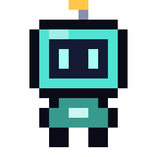
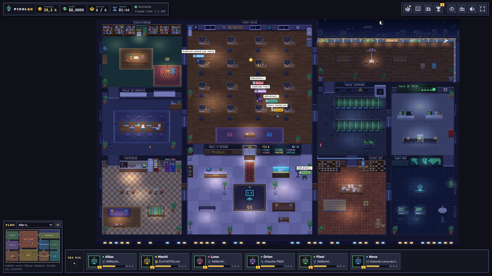
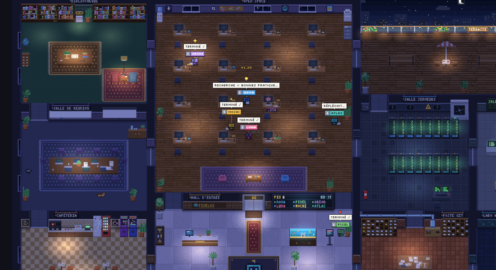
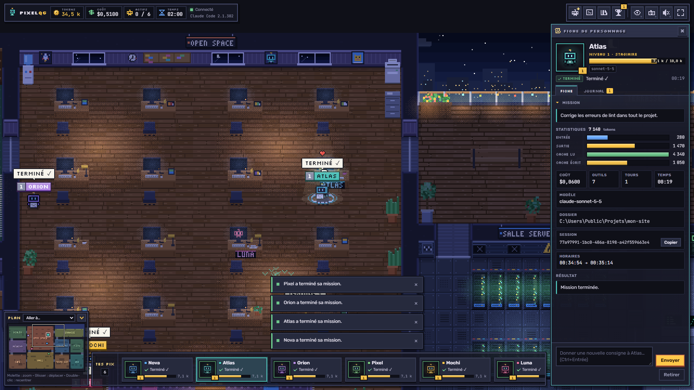

<div align="center">



# PixelQG

**Tes agents Claude Code deviennent des *pix* : regarde-les bosser dans un bureau en pixel art.**

[](LICENSE)
[](https://github.com/hugobertagna/pixelqg-app/releases/latest)


[**Télécharger pour Windows**](https://github.com/hugobertagna/pixelqg-app/releases/latest) ·
[**Le site**](https://pixelqg-site.pages.dev) ·
[**Communauté**](https://github.com/hugobertagna/pixelqg-app/discussions) ·
[**Guide complet**](docs/GUIDE.md)



</div>

## Pourquoi PixelQG ?

Dans un terminal, un agent Claude Code est une longue suite de lignes. Quand tu en lances plusieurs, tu ne sais plus qui fait quoi, depuis combien de temps, ni pour combien de tokens.

PixelQG transforme chaque agent en **pix**, un petit robot qui se déplace dans un bureau selon ce qu'il fait. Il lit un fichier ? Il file à la bibliothèque. Il lance des tests ? Direction la salle serveurs. Il délègue ? Son sous-pix le rejoint en réunion. Tokens, coût et temps de travail s'affichent en direct.

Tout tourne sur ton PC : PixelQG ne t'envoie nulle part, et ne demande aucun compte.

## Ce que tu peux faire

- **Lancer des pix** avec une mission, un nom, une couleur, un modèle et un mode de permission.
- **Les regarder travailler** dans dix pièces, avec le jour et la nuit qui suivent ton heure.
- **Suivre chaque pix** : tokens en entrée, en sortie et en cache, coût, outils utilisés, journal complet.
- **Taper `claude` dans le terminal intégré** : ta session apparaît aussitôt dans le bureau.
- **Ajouter des skills et des agents** depuis n'importe quel dépôt GitHub public, dans l'onglet Bibliothèque.
- **Voir tes autres sessions Claude Code**, lancées ailleurs sur ton PC, comme des visiteurs.
- **Gagner des niveaux et des succès** au fil des tokens, avec le chat de bureau en prime.

<div align="center">


</div>

## Les pièces du bureau

| Pièce | Ce que le pix y fait |
|---|---|
| Open space | Écrit et modifie du code à son bureau |
| Bibliothèque | Lit des fichiers et cherche dans le projet |
| Salle serveurs | Lance des commandes |
| Salle de tests | Lance les tests, le tableau passe au vert ou au rouge |
| Poste Git | Fait ses commits et ses push |
| Labo web | Cherche sur le web, utilise des outils connectés |
| Salle de réunion | Délègue à des sous-pix |
| Cafétéria et terrasse | Fait une pause quand sa mission est terminée |

## Installer

**Prérequis :** [Claude Code](https://docs.claude.com/fr/docs/claude-code) installé et connecté à ton compte. L'usage de Claude reste facturé par Anthropic, comme d'habitude.

**Windows (recommandé)**
1. Télécharge `PixelQG-Setup-<version>.exe` depuis les [releases](https://github.com/hugobertagna/pixelqg-app/releases/latest).
2. Lance-le. Comme l'installateur n'est pas signé, Windows peut afficher « Windows a protégé votre ordinateur » : clique sur **Informations complémentaires**, puis **Exécuter quand même**.
3. PixelQG s'installe avec son propre Node.js et crée un raccourci sur ton bureau.

Une version portable, en zip, est aussi disponible dans chaque release.

**Depuis le code (Windows, macOS, Linux)**

```bash
git clone https://github.com/hugobertagna/pixelqg-app.git
cd pixelqg-app
node server/server.js --open
```

Il faut Node.js 20 ou plus récent. Sur macOS et Linux, le support est **expérimental** : le terminal intégré ne suit pas le redimensionnement. Lance `./start.sh`, ou `launcher/PixelQG.command` sur macOS.

Tout le détail est dans le [guide complet](docs/GUIDE.md) : modes de permission, terminal, bibliothèque, sécurité et dépannage.

## Communauté

PixelQG est un projet communautaire, et toutes les contributions comptent.

- **Partage tes skills et tes agents** dans les [Discussions](https://github.com/hugobertagna/pixelqg-app/discussions). Les autres pourront les ajouter à leur bibliothèque d'un simple lien.
- **Signale un bug ou propose une idée** dans les [issues](https://github.com/hugobertagna/pixelqg-app/issues).
- **Contribue au code**, aux graphismes ou aux traductions : lis le [guide de contribution](CONTRIBUTING.md).

## Confidentialité et sécurité

- Le serveur de PixelQG écoute seulement sur ton PC (`127.0.0.1`), protégé par un jeton.
- PixelQG ne collecte rien et n'a besoin d'aucun compte.
- Les dépôts de la bibliothèque n'apportent que des skills, des agents et des commandes : leurs hooks et serveurs MCP ne sont jamais chargés.

## Licence

[MIT](LICENSE) : tu peux utiliser, modifier et partager PixelQG librement.

PixelQG est un projet indépendant, compatible avec Claude Code. Il n'est pas affilié à Anthropic. Claude et Claude Code sont des marques d'Anthropic.

---

<details>
<summary><strong>In English</strong></summary>

**PixelQG** turns your Claude Code agents into *pix*: little robots that walk around a pixel-art office depending on what they are doing. They go to the library to read files, the server room to run commands, the meeting room to delegate to sub-agents, and so on. It shows tokens, cost and working time live, has an integrated terminal that links any `claude` session to the office, and lets you load skills and agents from public GitHub repositories.

It is free and open source (MIT) and runs entirely on your machine. Windows is fully supported; macOS and Linux are experimental. The interface is in French for now, and translations are very welcome: see [CONTRIBUTING.md](CONTRIBUTING.md).

</details>
